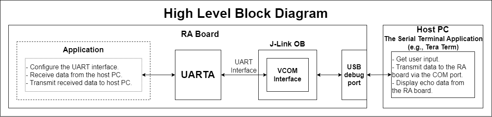
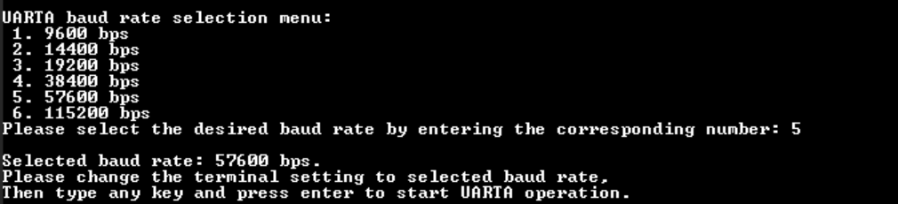
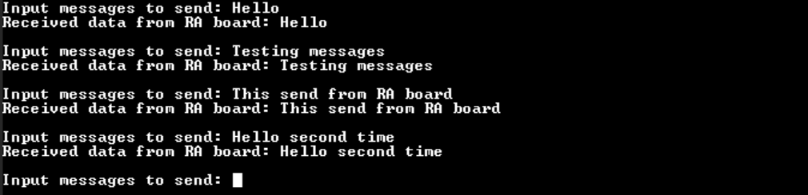

# UARTA	SERIAL COMM #
# Introduction #
The example project demonstrates the basic functionality of the UARTA driver on Renesas RA MCUs based on FSP, the Virtual COM is used as example usage of the UARTA. The user can select UARTA baud rate from the menu on the terminal (e.g., 9600 bps, 14400 bps, 19200 bps,...). After selecting the baud rate, the user needs to reconfigure parameters for the terminal application. Then the user can enter and send an ASCII string (up to 256 characters) from the terminal to the RA board, which will also be echoed back to the terminal by the RA board.

Please refer to the [Example Project Usage Guide](https://github.com/renesas/ra-fsp-examples/blob/master/example_projects/Example%20Project%20Usage%20Guide.pdf) for general information on example projects and [readme.txt](./readme.txt) for specifics of operation.

## Required Resources ## 
To build and run the UARTA example project, the following resources are needed.

### Software ###
* Renesas Flexible Software Package (FSP): Version 6.5.0
* e2 studio: Version 2026-04.2
* LLVM Embedded Toolchain for ARM: Version 21.1.1
* Terminal Console Application: Tera Term or a similar application

### Hardware Requirements ###
* Supported RA boards: FPB-RA0E1, FPB-RA0E2, EK-RA4C1, FPB-RA0L1.
	* 1 x RA board.
	* 1 x USB cable for programming and debugging (USB cable type varies by board model).
	* For RA boards do not support J-Link On Board VCOM functionality on UARTA: EK-RA4C1.
		* 1 x Pmod USBUART (e.g., Pmod USBUART: https://digilent.com/shop/pmod-usbuart-usb-to-uart-interface/) module for converting data from the USB interface to the UART interface and vice versa.
		* 1 x Micro USB cable for connecting the Pmod USBUART to the host PC.
		* Some jumper wires.

### Hardware Connections ###
* Connect the RA board USB debug port to the host PC using the appropriate USB cable for EP programming and debugging.

* For FPB-RA0E1:
    * To use J-Link OB VCOM:
        * Short the E4 trace.
        * Replace R10 by 150ohm resistor.

* For FPB-RA0E2:
    * To use J-Link OB VCOM:
		* Short the E46, E47 traces.

* For EK-RA4C1:
	* The user must place jumper J6 on pins 2-3, J8 on pins 1-2, J9 on pins 2-3 and turn OFF SW4-4 to use the on-board debug functionality.
	* The user must close E52 to use P305.
	* Connect RxDA0 P305 (J2:38) to TXD Pin of Pmod USBUART (J2:3).
	* Connect TxDA0 P306 (J2:36) to RXD Pin of Pmod USBUART (J2:2).
	* Connect GND (J2:2) to GND Pin of Pmod USBUART (J2:5).
    * Connect the Pmod USBUART Board (J1) to the host PC via a micro USB cable.

* For FPB-RA0L1:
	* To use J-Link OB VCOM for Serial Terminal (UART), the user must close E28, E29.
	* To use the on-board debug functionality, the user must place jumper J9 on pins 1-2.

Refer to the software required section in [Example Project Usage Guide](https://github.com/renesas/ra-fsp-examples/blob/master/example_projects/Example%20Project%20Usage%20Guide.pdf) for basic information on setting up and using the above software.

## Related Collateral References ##
The following documents can be referred to for enhancing your understanding of the operation of this example project:
* [FSP User Manual on GitHub](https://renesas.github.io/fsp/)
* [FSP Known Issues](https://github.com/renesas/fsp/issues)

# Project Notes #

## System Level Block Diagram ##
High level block diagram of the system is shown below:
 

## FSP Modules Used ##
List all the various modules that are used in this example project. Refer to the FSP User Manual for further details on each module listed below.

| Module Name | Usage | Searchable Keyword  |
|-------------|-----------------------------------------------|-----------------------------------------------|
| UARTA | UARTA is used to communicate with the serial terminal on the host PC via the UART interface. | r_uarta |

## Module Configuration Notes ##
This section describes FSP Configurator properties which are important or different from those selected by default. 

**Configuration Properties for using UARTA**

|   Module Property Path and Identifier   |   Default Value   |   Used Value   |   Reason   |
|-----------------------------------------|-------------------|----------------|------------|
| configuration.xml > Stacks > g_uarta UART (r_uarta) > Properties > Settings > Property > Common > DTC Support | Disabled | Enabled | Enable DTC for support the UARTA module. |
| configuration.xml > Stacks > g_uarta UART (r_uarta) > Properties > Settings > Property > Common > Receive Error Interrupt Mode | Enabled | Enabled | The UARTA0_ERRI interrupt is generated when a reception error occurs, so parity, framing, and overflow errors can be reported to the application. |
| configuration.xml > Stacks > g_uarta UART (r_uarta) > Properties > Settings > Property > Module g_uarta UART (r_uarta) > General > Channel | 1 | 1 | Use UARTA channel 1 to communicate with the terminal application on the host PC. |
| configuration.xml > Stacks > g_uarta UART (r_uarta) > Properties > Settings > Property > Module g_uarta UART (r_uarta) > General > Data Bits | 8bits | 8bits | Select 8 bits data length. |
| configuration.xml > Stacks > g_uarta UART (r_uarta) > Properties > Settings > Property > Module g_uarta UART (r_uarta) > General > Parity | None | None | Select no check Parity. |
| configuration.xml > Stacks > g_uarta UART (r_uarta) > Properties > Settings > Property > Module g_uarta UART (r_uarta) > General > Stop Bits | 1bit | 1bit | Select 1 bit stop. |
| configuration.xml > Stacks > g_uarta UART (r_uarta) > Properties > Settings > Property > Module g_uarta UART (r_uarta) > Extra > Transfer Order | LSB first | LSB first | Select LSB first for transmission and reception order. |
| configuration.xml > Stacks > g_uarta UART (r_uarta) > Properties > Settings > Property > Module g_uarta UART (r_uarta) > Extra > Transfer level | Positive logic | Positive logic | Select Positive logic for transmission and reception level. |
| configuration.xml > Stacks > g_uarta UART (r_uarta) > Properties > Settings > Property > Module g_uarta UART (r_uarta) > Interrupts > Callback | NULL | uarta_callback | It is called from the interrupt service routine (ISR) upon UARTA transaction completion reporting the transaction status. |
| configuration.xml > Stacks > g_uarta UART (r_uarta) > Properties > Settings > Property > Module g_uarta UART (r_uarta) > Interrupts > Receive Interrupt Priority | Priority 2 | Priority 2 | Select the UARTA receive interrupt priority level. |
| configuration.xml > Stacks > g_uarta UART (r_uarta) > Properties > Settings > Property > Module g_uarta UART (r_uarta) > Interrupts > Transmit Interrupt Priority | Priority 2 | Priority 2 | Select the UARTA transmit interrupt priority level. |
| configuration.xml > Stacks > g_uarta UART (r_uarta) > Properties > Settings > Property > Module g_uarta UART (r_uarta) > Interrupts > Error Interrupt Priority | Disabled | Priority 2 | Select the UARTA error priority level. |

|   Configure Clock path   |   Default Value   |   Used Value   |   Reason   |
|-----------------------------------------|-------------------|----------------|------------|
| configuration.xml > Clocks > Clocks Configuration | UTASEL Disabled | UTASEL Src: HOCO | Select HOCO clock source as the source operating clock for UARTA module. |

## API Usage ##
The table below lists the FSP provided API used at the application layer in this example project.

| API Name    | Usage                                                                          |
|-------------|--------------------------------------------------------------------------------|
| R_UARTA_Open | This API is used to initialize the UARTA module. |
| R_UARTA_Write | This API is used to perform a write operation. |
| R_UARTA_Close | This API is used to de-initialize the UARTA module. |
| R_UARTA_BaudCalculate | This API is used to calculate baud rate register settings for UARTA module. |
| R_BSP_SoftwareDelay | This API is used to delay a specified period of time. |

## Verifying Operation ##
1. Import, generate, and build the example project.
2. Refer to the [Hardware Connections](#hardware-connections) section to set up hardware properly.
3. Flash or debug the example project.
4. Open a serial terminal application (e.g., Tera Term) to view output log, configure the settings as shown below:
    * To make sure the received data shows properly, the user needs to set:
        * [Setup] -> [Terminal...] -> [New-line] -> Select [Receive: CR] & [Transmit: CR].
    * To echo back characters typed in Tera Term, the user needs to enable it through: 
        * [Setup] -> [Terminal...] -> Check [Local echo].
    * The configuration parameters of the serial port on the serial terminal application:
        * Port: The port is provided by the J-Link On-Board.
        * Speed: 115200
		* Data: 8 bit
		* Parity: none
		* Stop bits: 1 bit
		* Flow control: none
5. After the main menu is displayed on the terminal, the user can select the baud rate option as desired.
	* Type '1' to select baud rate = 9600 bps.
	* Type '2' to select baud rate = 14400 bps.
	* Type '3' to select baud rate = 19200 bps.
	* Type '4' to select baud rate = 38400 bps.
	* Type '5' to select baud rate = 57600 bps.
	* Type '6' to select baud rate = 115200 bps.
6. Configure baud rate of the terminal application to match the selected baud rate displayed on the terminal.
7. Type any ASCII key into the terminal, then press the Enter key to start UARTA operation.
8. Type any ASCII string (up to 256 characters) into the terminal, then press the Enter key to send.
9. View the output log on the terminal.

The images below showcase the output on the terminal:  
Baud rate selection and operation start:  

String transmission and echo:  

